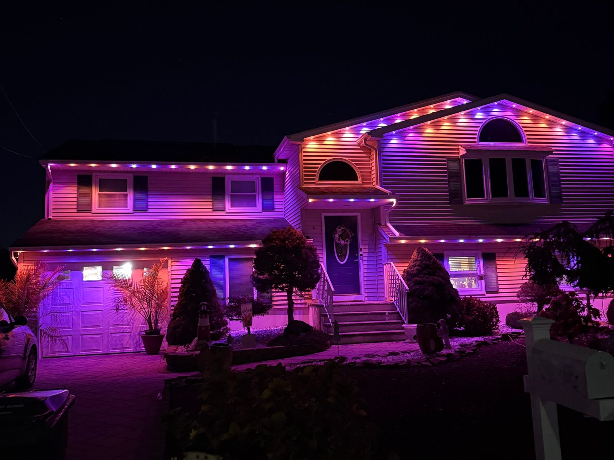

# Permanent lights, installed in Ocean & Monmouth County

Put them up once and use them all year. Christmas, the 4th, Halloween, game day or plain white, all from your phone.

Source: https://www.trlightsnj.com/permanent-lights
TR Lights · Toms River, NJ · Text (732) 955-1026 · Free quote: https://www.trlightsnj.com/#quote

> **Short answer:** TR Lights installs Govee permanent lights under the roofline of 1, 2 and 3-story homes across Ocean and Monmouth County, NJ. You pick the color and effect from the Govee app, and there are no ladders for you ever again.

## What you get

- Govee permanent lights mounted under your roofline
- Any color or effect, changed from your phone
- Hard to spot during the day
- Rooflines, patios, pavilions and pergolas
- 1, 2 and 3-story homes, steep roofs included
- Installed by a fully insured local crew from Toms River

## Every holiday from one install

Christmas in December. Red, white and blue for the 4th. Orange and purple for Halloween. Team colors on game day. Warm white the rest of the year. One install covers all of it.

## How it works

- **Send your address.** Use the [quote form](/#quote) or text a photo of your house.
- **Get your price by text.** Every house is different, so we price yours, usually the same day.
- **We install.** The lights stay up and work all year.

## Permanent lights or seasonal Christmas lights?

If you only want lights in December, our [Christmas light installation](/) is the simpler pick: we hang them, then take them down in January. If you'd use lights for more than one holiday, permanent lights make more sense. Read the full comparison: [Permanent lights vs. Christmas lights](/guides/permanent-lights-vs-christmas-lights).

## Questions

### What brand of permanent lights do you install?

Govee permanent lights. They mount under your roofline and run from the Govee app on your phone.

### Can I change the colors myself?

Yes. You pick any color or effect from the Govee app, for any holiday or any night.

### Can you see permanent lights during the day?

They tuck under the roofline, so they are hard to spot during the day.

### Do you install on 2 and 3-story homes?

Yes. We install on 1, 2 and 3-story homes, including steep roofs and high peaks.

### How much do permanent lights cost?

Every house is different, so we price yours. Send your address and we'll text you a price, free.

### What areas do you serve?

All of Ocean and Monmouth County, NJ, including Toms River, Brick, Point Pleasant, Lakewood, Jackson, Seaside, Lavallette, Bayville, Forked River, Barnegat, Manasquan, Wall, Belmar, Howell, Freehold, Red Bank, Middletown.
